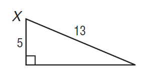
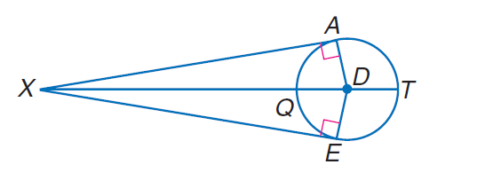

# AVP0316 — Single visual target

MathVista:333 / MathVista:403 · same type · Mathematical roles of symbols

## Shared or similar visual information

The letter X

## Evidence locations

- Left image: X at the upper-left vertex of the right triangle
- Right image: X at the left exterior point of the circle construction

## Mathematical meanings

Left image: X names the indicated geometric point. Right image: X names the indicated geometric point.

## Same mathematical meanings

yes

## Rationales

The left occurrence is located at X at the upper-left vertex of the right triangle; the right occurrence is at X at the left exterior point of the circle construction. Both use the selected notation for the same point-naming function. This compares the local role, without asserting that the two underlying objects or unknown values are identical.

Only the selected target is annotated. AI visual-review draft; not independently double-annotated by humans.
