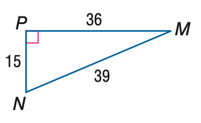
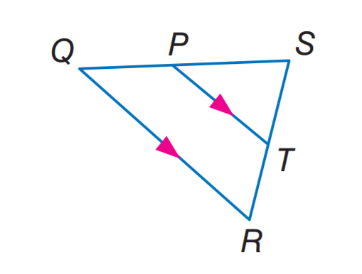

# AVP0319 — Single visual target

MathVista:388 / MathVista:414 · same type · Mathematical roles of symbols

## Shared or similar visual information

The letter P

## Evidence locations

- Left image: P at the upper-left right-angle vertex
- Right image: P at the division point on the top side

## Mathematical meanings

Left image: P names the indicated geometric point. Right image: P names the indicated geometric point.

## Same mathematical meanings

yes

## Rationales

The left occurrence is located at P at the upper-left right-angle vertex; the right occurrence is at P at the division point on the top side. Both use the selected notation for the same point-naming function. This compares the local role, without asserting that the two underlying objects or unknown values are identical.

Only the selected target is annotated. AI visual-review draft; not independently double-annotated by humans.
