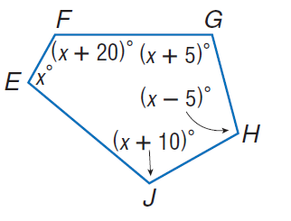
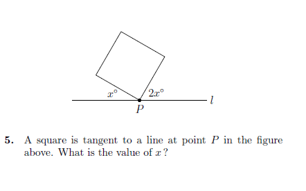

# AVP0321 — Single visual target

MathVista:5 / MathVista:88 · same type · Mathematical roles of symbols

## Shared or similar visual information

The letter x

## Evidence locations

- Left image: x° at the left vertex E of the pentagon
- Right image: x° immediately above the line to the left of P

## Mathematical meanings

Left image: x denotes the unknown angle measure at E, in degrees. Right image: x denotes the unknown angle between the line and a side of the square, in degrees.

## Same mathematical meanings

yes

## Rationales

The left occurrence is located at x° at the left vertex E of the pentagon; the right occurrence is at x° immediately above the line to the left of P. Both use the selected notation for the same unknown-angle variable role. This compares the local role, without asserting that the two underlying objects or unknown values are identical.

Only the selected target is annotated. AI visual-review draft; not independently double-annotated by humans.
