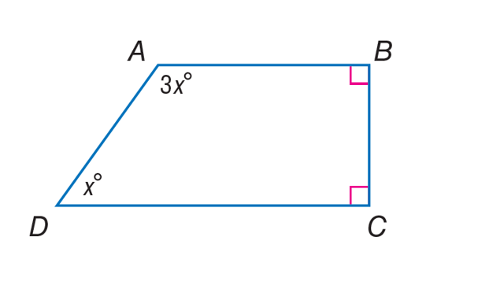
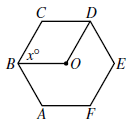

# AVP0322 — Single visual target

MathVista:242 / MathVista:280 · same type · Mathematical roles of symbols

## Shared or similar visual information

The letter x

## Evidence locations

- Left image: x° at the lower-left vertex D
- Right image: x° at B between BC and BO

## Mathematical meanings

Left image: x denotes the unknown angle measure at D, in degrees. Right image: x denotes the unknown angle measure between BC and BO, in degrees.

## Same mathematical meanings

yes

## Rationales

The left occurrence is located at x° at the lower-left vertex D; the right occurrence is at x° at B between BC and BO. Both use the selected notation for the same unknown-angle variable role. This compares the local role, without asserting that the two underlying objects or unknown values are identical.

Only the selected target is annotated. AI visual-review draft; not independently double-annotated by humans.
