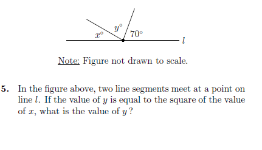

# AVP0323 — Single visual target

MathVista:304 / MathVista:386 · same type · Mathematical roles of symbols

## Shared or similar visual information

The letter y

## Evidence locations

- Left image: y° between the two upward rays
- Right image: y° near the top of the right triangle

## Mathematical meanings

Left image: y denotes the unknown angle measure between the upward rays, in degrees. Right image: y denotes the unknown angle at the top vertex, in degrees.

## Same mathematical meanings

yes

## Rationales

The left occurrence is located at y° between the two upward rays; the right occurrence is at y° near the top of the right triangle. Both use the selected notation for the same unknown-angle variable role. This compares the local role, without asserting that the two underlying objects or unknown values are identical.

Only the selected target is annotated. AI visual-review draft; not independently double-annotated by humans.
