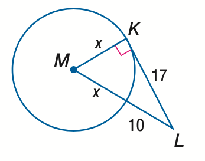
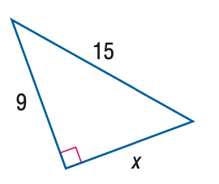

# AVP0324 — Single visual target

MathVista:114 / MathVista:160 · same type · Mathematical roles of symbols

## Shared or similar visual information

The letter x

## Evidence locations

- Left image: x next to radius MK
- Right image: x below the lower sloping side of the right triangle

## Mathematical meanings

Left image: x denotes the unknown radius length MK. Right image: x denotes the unknown length of the lower leg.

## Same mathematical meanings

yes

## Rationales

The left occurrence is located at x next to radius MK; the right occurrence is at x below the lower sloping side of the right triangle. Both use the selected notation for the same unknown-length variable role. This compares the local role, without asserting that the two underlying objects or unknown values are identical.

Only the selected target is annotated. AI visual-review draft; not independently double-annotated by humans.
