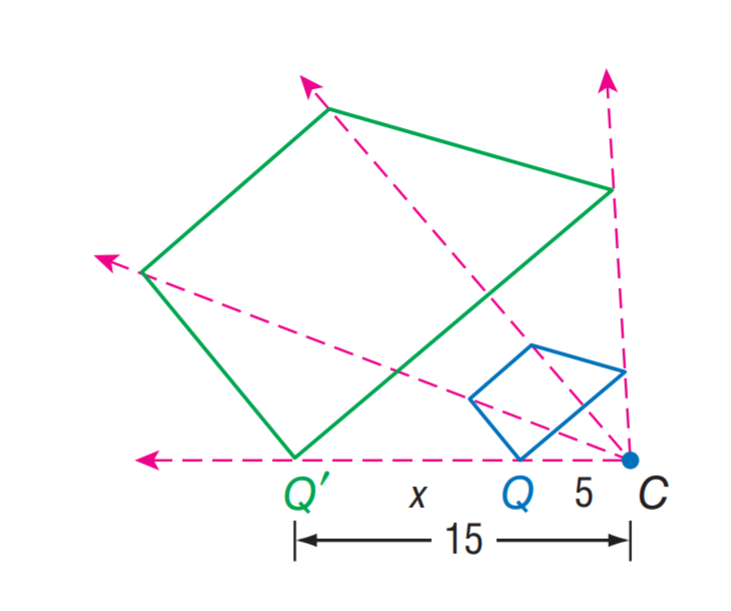
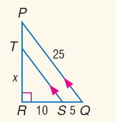

# AVP0325 — Single visual target

MathVista:206 / MathVista:238 · same type · Mathematical roles of symbols

## Shared or similar visual information

The letter x

## Evidence locations

- Left image: x above the dimension segment from Q-prime to Q
- Right image: x beside the left vertical segment TR

## Mathematical meanings

Left image: x denotes the unknown length from Q-prime to Q. Right image: x denotes the unknown length of segment TR.

## Same mathematical meanings

yes

## Rationales

The left occurrence is located at x above the dimension segment from Q-prime to Q; the right occurrence is at x beside the left vertical segment TR. Both use the selected notation for the same unknown-length variable role. This compares the local role, without asserting that the two underlying objects or unknown values are identical.

Only the selected target is annotated. AI visual-review draft; not independently double-annotated by humans.
