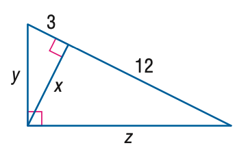

# AVP0326 — Single visual target

MathVista:273 / MathVista:408 · same type · Mathematical roles of symbols

## Shared or similar visual information

The letter x

## Evidence locations

- Left image: x beside the vertical double-headed dimension line
- Right image: x beside the interior perpendicular segment

## Mathematical meanings

Left image: x denotes the unknown vertical diagonal length of the diamond. Right image: x denotes the unknown altitude length to the hypotenuse.

## Same mathematical meanings

yes

## Rationales

The left occurrence is located at x beside the vertical double-headed dimension line; the right occurrence is at x beside the interior perpendicular segment. Both use the selected notation for the same unknown-length variable role. This compares the local role, without asserting that the two underlying objects or unknown values are identical.

Only the selected target is annotated. AI visual-review draft; not independently double-annotated by humans.
