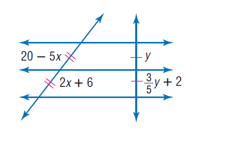

# AVP0327 — Single visual target

MathVista:310 / MathVista:271 · same type · Mathematical roles of symbols

## Shared or similar visual information

The letter y

## Evidence locations

- Left image: y beside the left vertical leg
- Right image: y beside the upper segment of the vertical transversal

## Mathematical meanings

Left image: y denotes the unknown length of the vertical leg. Right image: y denotes the unknown length of the upper vertical segment.

## Same mathematical meanings

yes

## Rationales

The left occurrence is located at y beside the left vertical leg; the right occurrence is at y beside the upper segment of the vertical transversal. Both use the selected notation for the same unknown-length variable role. This compares the local role, without asserting that the two underlying objects or unknown values are identical.

Only the selected target is annotated. AI visual-review draft; not independently double-annotated by humans.
