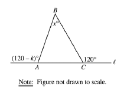
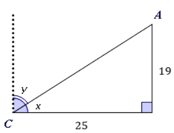

# AVP0328 — Single visual target

MathVista:434 / MathVerse:346 · same type · Mathematical roles of symbols

## Shared or similar visual information

The letter x

## Evidence locations

- Left image: x° at the top triangle vertex B
- Right image: x beside the lower angle arc at C

## Mathematical meanings

Left image: x denotes the unknown angle measure at B, in degrees. Right image: x denotes the unknown angle measure at C.

## Same mathematical meanings

yes

## Rationales

The left occurrence is located at x° at the top triangle vertex B; the right occurrence is at x beside the lower angle arc at C. Both use the selected notation for the same unknown-angle variable role. This compares the local role, without asserting that the two underlying objects or unknown values are identical.

Only the selected target is annotated. AI visual-review draft; not independently double-annotated by humans.
