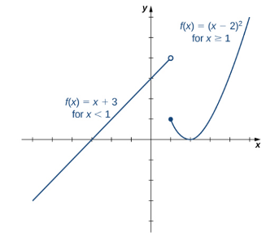
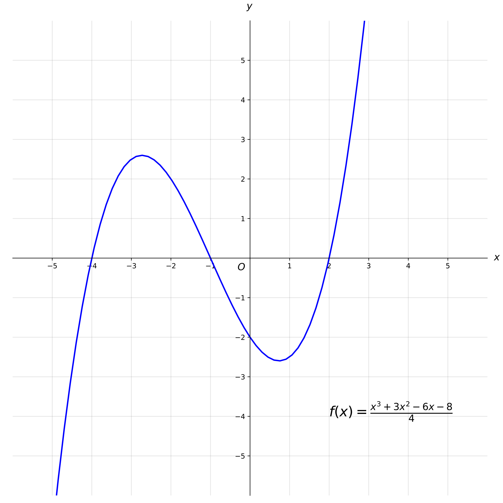

# AVP0332 — Single visual target

MathVista:156 / MathVista:167 · same type · Mathematical roles of symbols

## Shared or similar visual information

The letter f

## Evidence locations

- Left image: f(x) in the piecewise formulas beside the two branches
- Right image: f(x) at the start of the formula in the lower-right

## Mathematical meanings

Left image: f names the function represented by the indicated curve. Right image: f names the function represented by the indicated curve.

## Same mathematical meanings

yes

## Rationales

The left occurrence is located at f(x) in the piecewise formulas beside the two branches; the right occurrence is at f(x) at the start of the formula in the lower-right. Both use the selected notation for the same function-naming role. This compares the local role, without asserting that the two underlying objects or unknown values are identical.

Only the selected target is annotated. AI visual-review draft; not independently double-annotated by humans.
