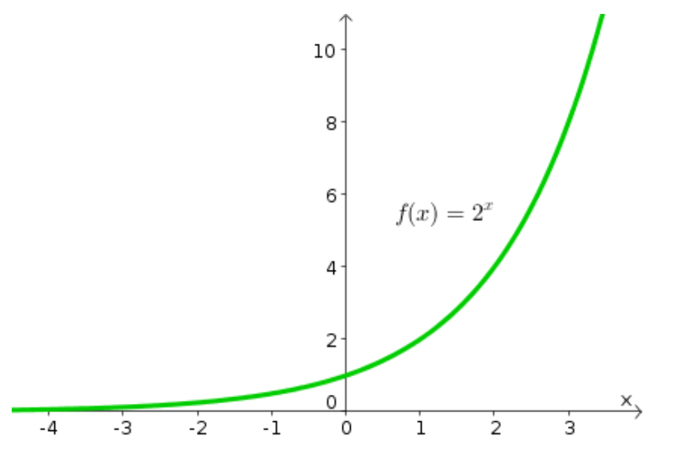

# AVP0333 — Single visual target

MathVista:369 / MathVista:619 · same type · Mathematical roles of symbols

## Shared or similar visual information

The lowercase letter f.

## Evidence locations

- Left image: f at the f in the formula f(x) = x³.
- Right image: f at the f in the exponential formula.

## Mathematical meanings

Left image: f names the plotted function (the f in the formula f(x) = x³). Right image: f names the plotted function (the f in the exponential formula).

## Same mathematical meanings

yes

## Rationales

In both images, f names the plotted function. The relevant locations are the f in the formula f(x) = x³ on the left and the f in the exponential formula on the right.

Only the selected target is annotated. AI visual-review draft; not independently double-annotated by humans.
