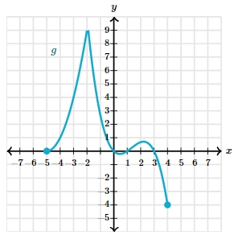
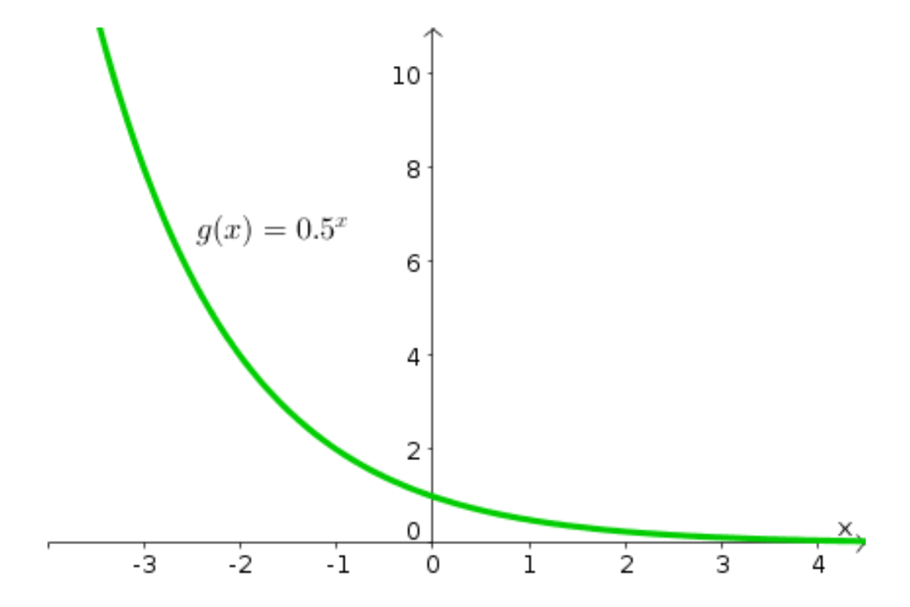

# AVP0335 — Single visual target

MathVerse:559 / MathVista:950 · same type · Mathematical roles of symbols

## Shared or similar visual information

The letter g

## Evidence locations

- Left image: g beside the cyan curve
- Right image: g(x) = 0.5^x beside the green curve

## Mathematical meanings

Left image: g names the function represented by the indicated curve. Right image: g names the function represented by the indicated curve.

## Same mathematical meanings

yes

## Rationales

The left occurrence is located at g beside the cyan curve; the right occurrence is at g(x) = 0.5^x beside the green curve. Both use the selected notation for the same function-naming role. This compares the local role, without asserting that the two underlying objects or unknown values are identical.

Only the selected target is annotated. AI visual-review draft; not independently double-annotated by humans.
