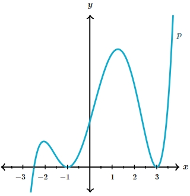
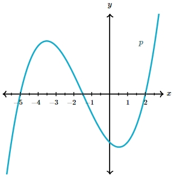

# AVP0336 — Single visual target

MathVerse:554 / MathVerse:576 · same type · Mathematical roles of symbols

## Shared or similar visual information

The letter p

## Evidence locations

- Left image: p beside the right branch of the curve
- Right image: p beside the upper-right curve

## Mathematical meanings

Left image: p names the function represented by the indicated curve. Right image: p names the function represented by the indicated curve.

## Same mathematical meanings

yes

## Rationales

The left occurrence is located at p beside the right branch of the curve; the right occurrence is at p beside the upper-right curve. Both use the selected notation for the same function-naming role. This compares the local role, without asserting that the two underlying objects or unknown values are identical.

Only the selected target is annotated. AI visual-review draft; not independently double-annotated by humans.
