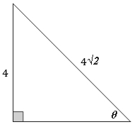
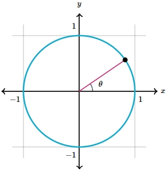

# AVP0338 — Single visual target

MathVerse:370 / MathVerse:555 · same type · Mathematical roles of symbols

## Shared or similar visual information

The letter θ

## Evidence locations

- Left image: θ beside the angle at the lower-right triangle vertex
- Right image: θ beside the angle from the positive horizontal axis to the radius

## Mathematical meanings

Left image: θ denotes the unknown angle at the lower-right vertex. Right image: θ denotes the angle between the radius and the positive horizontal axis.

## Same mathematical meanings

yes

## Rationales

The left occurrence is located at θ beside the angle at the lower-right triangle vertex; the right occurrence is at θ beside the angle from the positive horizontal axis to the radius. Both use the selected notation for the same unknown-angle variable role. This compares the local role, without asserting that the two underlying objects or unknown values are identical.

Only the selected target is annotated. AI visual-review draft; not independently double-annotated by humans.
