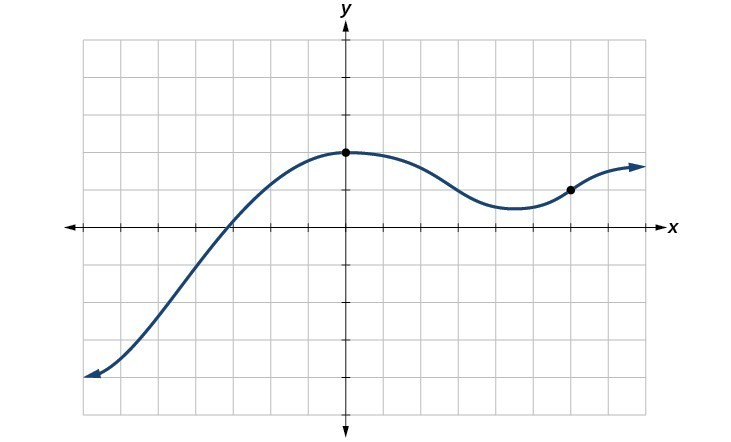

# AVP0343 — Single visual target

MathVerse:437 / MathVista:686 · different type · Mathematical roles of symbols

## Shared or similar visual information

The letter x

## Evidence locations

- Left image: x at the positive end of its coordinate axis
- Right image: x at the right end of the horizontal axis

## Mathematical meanings

Left image: x labels the horizontal coordinate axis. Right image: x labels the horizontal coordinate axis or independent-variable direction.

## Same mathematical meanings

yes

## Rationales

The left occurrence is located at x at the positive end of its coordinate axis; the right occurrence is at x at the right end of the horizontal axis. Both use the selected notation for the same horizontal coordinate-axis role. This compares the local role, without asserting that the two underlying objects or unknown values are identical.

Only the selected target is annotated. AI visual-review draft; not independently double-annotated by humans.
