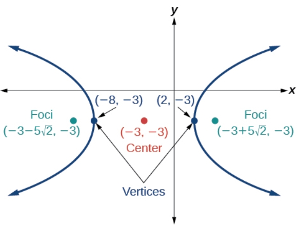

# AVP0344 — Single visual target

MathVerse:438 / MathVista:592 · different type · Mathematical roles of symbols

## Shared or similar visual information

The letter y

## Evidence locations

- Left image: y at the positive end of its coordinate axis
- Right image: y at the top of the vertical axis

## Mathematical meanings

Left image: y labels the vertical coordinate axis. Right image: y labels the vertical coordinate axis.

## Same mathematical meanings

yes

## Rationales

The left occurrence is located at y at the positive end of its coordinate axis; the right occurrence is at y at the top of the vertical axis. Both use the selected notation for the same vertical coordinate-axis role. This compares the local role, without asserting that the two underlying objects or unknown values are identical.

Only the selected target is annotated. AI visual-review draft; not independently double-annotated by humans.
