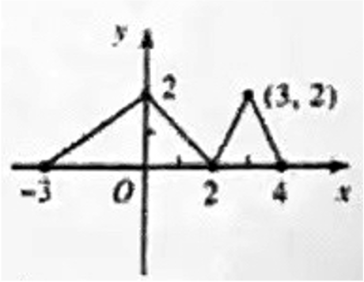
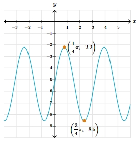

# AVP0345 — Single visual target

MathVista:117 / MathVerse:534 · same type · Mathematical roles of symbols

## Shared or similar visual information

Parentheses in mathematical notation

## Evidence locations

- Left image: (3, 2) beside the upper vertex of the right-hand triangular part
- Right image: (¼π, −2.2) beside the highlighted upper point on the wave

## Mathematical meanings

Left image: The parentheses contain an ordered pair giving the point coordinates: horizontal coordinate first and vertical coordinate second. Right image: The parentheses contain the highlighted point's ordered horizontal and vertical coordinates.

## Same mathematical meanings

yes

## Rationales

The left occurrence is located at (3, 2) beside the upper vertex of the right-hand triangular part; the right occurrence is at (¼π, −2.2) beside the highlighted upper point on the wave. Both use the selected notation for the same ordered-coordinate-pair notation. This compares the local role, without asserting that the two underlying objects or unknown values are identical.

Only the selected target is annotated. AI visual-review draft; not independently double-annotated by humans.
