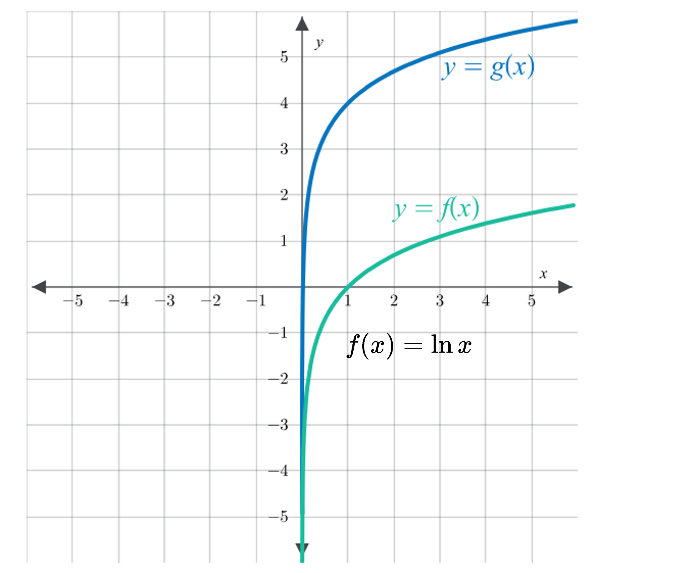

# AVP0347 — Single visual target

MathVista:156 / MathVerse:588 · same type · Mathematical roles of symbols

## Shared or similar visual information

Parentheses in mathematical notation

## Evidence locations

- Left image: (x) in f(x) = x + 3
- Right image: (x) in f(x) = ln x

## Mathematical meanings

Left image: The parentheses specify the input x of function f; f(x) denotes its output. Right image: The parentheses specify the input x of function f; f(x) denotes its output.

## Same mathematical meanings

yes

## Rationales

The left occurrence is located at (x) in f(x) = x + 3; the right occurrence is at (x) in f(x) = ln x. Both use the selected notation for the same function-input notation. This compares the local role, without asserting that the two underlying objects or unknown values are identical.

Only the selected target is annotated. AI visual-review draft; not independently double-annotated by humans.
