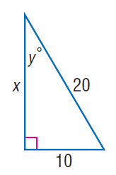
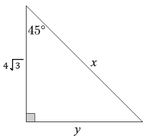

# AVP0349 — Single visual target

MathVista:386 / MathVerse:375 · same type · Mathematical roles of symbols

## Shared or similar visual information

The letter x

## Evidence locations

- Left image: x beside the left vertical leg
- Right image: x beside the sloping hypotenuse

## Mathematical meanings

Left image: x denotes the unknown length of the vertical leg. Right image: x denotes the unknown length of the hypotenuse.

## Same mathematical meanings

yes

## Rationales

The left occurrence is located at x beside the left vertical leg; the right occurrence is at x beside the sloping hypotenuse. Both use the selected notation for the same unknown-length variable role. This compares the local role, without asserting that the two underlying objects or unknown values are identical.

Only the selected target is annotated. AI visual-review draft; not independently double-annotated by humans.
