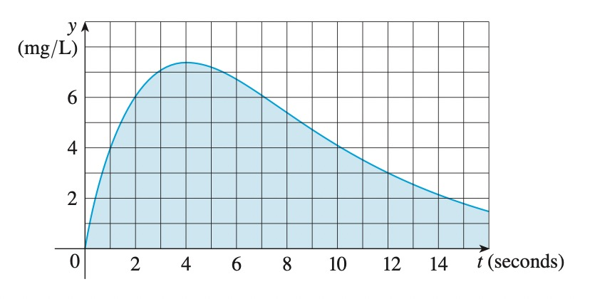

# AVP0350 — Single visual target

MathVerse:546 / MathVista:641 · same type · Mathematical roles of symbols

## Shared or similar visual information

The letter t

## Evidence locations

- Left image: t at the right end of the horizontal axis
- Right image: t (seconds) beside the horizontal axis

## Mathematical meanings

Left image: t labels the horizontal independent-variable axis. Right image: t labels the horizontal independent-variable axis; its displayed unit is seconds.

## Same mathematical meanings

yes

## Rationales

The left occurrence is located at t at the right end of the horizontal axis; the right occurrence is at t (seconds) beside the horizontal axis. Both use the selected notation for the same horizontal coordinate-axis role. This compares the local role, without asserting that the two underlying objects or unknown values are identical.

Only the selected target is annotated. AI visual-review draft; not independently double-annotated by humans.
