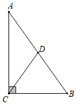
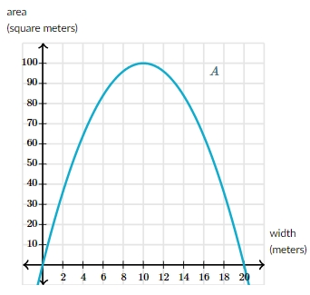

# AVP0351 — Single visual target

MathVista:17 / MathVerse:574 · different type · Mathematical roles of symbols

## Shared or similar visual information

The letter A

## Evidence locations

- Left image: A at the upper endpoint of the vertical side
- Right image: A beside the curve whose vertical axis is labeled area (square meters)

## Mathematical meanings

Left image: A names the indicated geometric point. Right image: A names the plotted area function, with output measured in square meters.

## Same mathematical meanings

no

## Rationales

On the left, attachment to A at the upper endpoint of the vertical side supports the meaning: A names the indicated geometric point. On the right, the context is A beside the curve whose vertical axis is labeled area (square meters), where A names the plotted area function, with output measured in square meters. The same visible notation is assigned to different mathematical objects or quantities in these contexts.

Only the selected target is annotated. AI visual-review draft; not independently double-annotated by humans.
