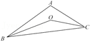
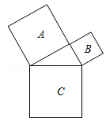

# AVP0352 — Single visual target

MathVista:3 / MathVista:9 · same type · Mathematical roles of symbols

## Shared or similar visual information

The letter A

## Evidence locations

- Left image: A at the top vertex of the triangle
- Right image: A inside the upper-left square

## Mathematical meanings

Left image: A names the indicated geometric point. Right image: A identifies the indicated square region rather than a vertex.

## Same mathematical meanings

no

## Rationales

On the left, attachment to A at the top vertex of the triangle supports the meaning: A names the indicated geometric point. On the right, the context is A inside the upper-left square, where A identifies the indicated square region rather than a vertex. The same visible notation is assigned to different mathematical objects or quantities in these contexts.

Only the selected target is annotated. AI visual-review draft; not independently double-annotated by humans.
