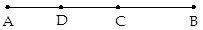
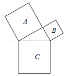

# AVP0353 — Single visual target

MathVista:6 / MathVista:9 · same type · Mathematical roles of symbols

## Shared or similar visual information

The letter B

## Evidence locations

- Left image: B above the right endpoint of the horizontal segment
- Right image: B inside the upper-right square

## Mathematical meanings

Left image: B names the indicated geometric point. Right image: B identifies the indicated square region rather than a vertex.

## Same mathematical meanings

no

## Rationales

On the left, attachment to B above the right endpoint of the horizontal segment supports the meaning: B names the indicated geometric point. On the right, the context is B inside the upper-right square, where B identifies the indicated square region rather than a vertex. The same visible notation is assigned to different mathematical objects or quantities in these contexts.

Only the selected target is annotated. AI visual-review draft; not independently double-annotated by humans.
