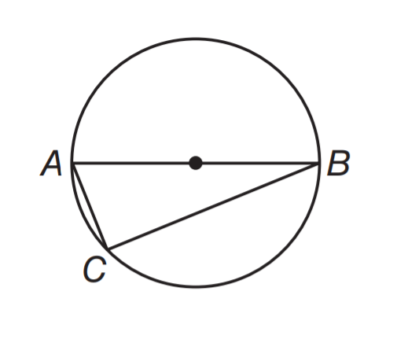
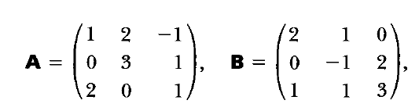

# AVP0354 — Single visual target

MathVista:28 / MathVista:577 · different type · Mathematical roles of symbols

## Shared or similar visual information

The letter B

## Evidence locations

- Left image: B at the right endpoint of the diameter
- Right image: B immediately before the equals sign and its 3-by-3 array

## Mathematical meanings

Left image: B names the indicated geometric point. Right image: B names a 3-by-3 matrix.

## Same mathematical meanings

no

## Rationales

On the left, attachment to B at the right endpoint of the diameter supports the meaning: B names the indicated geometric point. On the right, the context is B immediately before the equals sign and its 3-by-3 array, where B names a 3-by-3 matrix. The same visible notation is assigned to different mathematical objects or quantities in these contexts.

Only the selected target is annotated. AI visual-review draft; not independently double-annotated by humans.
