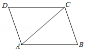
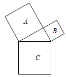

# AVP0355 — Single visual target

MathVista:32 / MathVista:9 · same type · Mathematical roles of symbols

## Shared or similar visual information

The letter C

## Evidence locations

- Left image: C at the upper-right quadrilateral vertex
- Right image: C inside the lower square

## Mathematical meanings

Left image: C names the indicated geometric point. Right image: C identifies the indicated square region rather than a vertex.

## Same mathematical meanings

no

## Rationales

On the left, attachment to C at the upper-right quadrilateral vertex supports the meaning: C names the indicated geometric point. On the right, the context is C inside the lower square, where C identifies the indicated square region rather than a vertex. The same visible notation is assigned to different mathematical objects or quantities in these contexts.

Only the selected target is annotated. AI visual-review draft; not independently double-annotated by humans.
