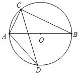

# AVP0357 — Single visual target

MathVista:59 / MathVista:117 · different type · Mathematical roles of symbols

## Shared or similar visual information

The letter O

## Evidence locations

- Left image: O beside the center point on the horizontal diameter
- Right image: O beside the intersection of the two axes

## Mathematical meanings

Left image: O names the center of the circle. Right image: O identifies the coordinate origin where the axes intersect.

## Same mathematical meanings

no

## Rationales

On the left, attachment to O beside the center point on the horizontal diameter supports the meaning: O names the center of the circle. On the right, the context is O beside the intersection of the two axes, where O identifies the coordinate origin where the axes intersect. The same visible notation is assigned to different mathematical objects or quantities in these contexts.

Only the selected target is annotated. AI visual-review draft; not independently double-annotated by humans.
