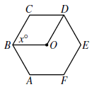
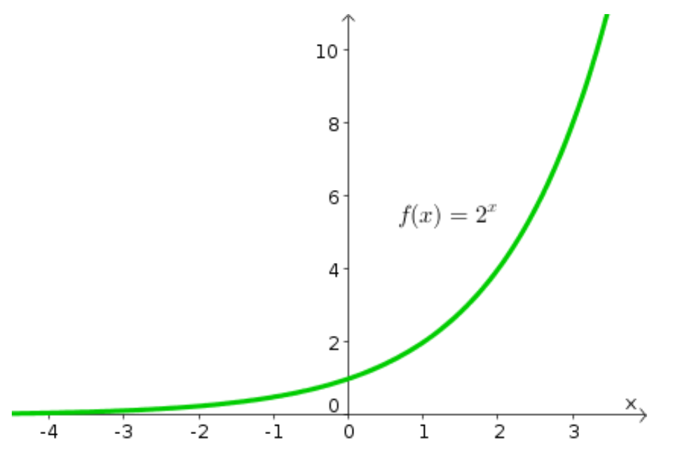

# AVP0361 — Single visual target

MathVista:280 / MathVista:619 · different type · Mathematical roles of symbols

## Shared or similar visual information

The letter x

## Evidence locations

- Left image: x° at B between BC and BO
- Right image: x at the right end of the horizontal axis

## Mathematical meanings

Left image: x denotes the unknown angle measure between BC and BO, in degrees. Right image: x labels the horizontal coordinate axis or independent-variable direction.

## Same mathematical meanings

no

## Rationales

On the left, attachment to x° at B between BC and BO supports the meaning: x denotes the unknown angle measure between BC and BO, in degrees. On the right, the context is x at the right end of the horizontal axis, where x labels the horizontal coordinate axis or independent-variable direction. The same visible notation is assigned to different mathematical objects or quantities in these contexts.

Only the selected target is annotated. AI visual-review draft; not independently double-annotated by humans.
