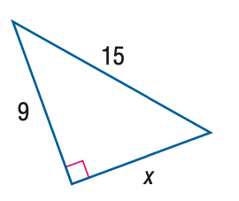

# AVP0369 — Single visual target

MathVista:160 / MathVista:409 · same type · Mathematical roles of symbols

## Shared or similar visual information

The letter x

## Evidence locations

- Left image: x below the lower sloping side of the right triangle
- Right image: x at the right end of the horizontal coordinate axis

## Mathematical meanings

Left image: x denotes the unknown length of the lower leg. Right image: x labels the horizontal coordinate axis.

## Same mathematical meanings

no

## Rationales

On the left, attachment to x below the lower sloping side of the right triangle supports the meaning: x denotes the unknown length of the lower leg. On the right, the context is x at the right end of the horizontal coordinate axis, where x labels the horizontal coordinate axis. The same visible notation is assigned to different mathematical objects or quantities in these contexts.

Only the selected target is annotated. AI visual-review draft; not independently double-annotated by humans.
