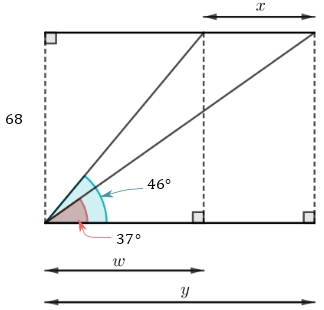

# AVP0381 — Single visual target

MathVerse:358 / MathVista:592 · different type · Mathematical roles of symbols

## Shared or similar visual information

The letter y

## Evidence locations

- Left image: y on the longest horizontal dimension below the construction
- Right image: y at the top of the vertical axis

## Mathematical meanings

Left image: y denotes the unknown overall width of the construction. Right image: y labels the vertical coordinate axis.

## Same mathematical meanings

no

## Rationales

On the left, attachment to y on the longest horizontal dimension below the construction supports the meaning: y denotes the unknown overall width of the construction. On the right, the context is y at the top of the vertical axis, where y labels the vertical coordinate axis. The same visible notation is assigned to different mathematical objects or quantities in these contexts.

Only the selected target is annotated. AI visual-review draft; not independently double-annotated by humans.
