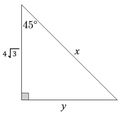

# AVP0382 — Single visual target

MathVerse:375 / MathVista:137 · different type · Mathematical roles of symbols

## Shared or similar visual information

The letter y

## Evidence locations

- Left image: y below the horizontal base
- Right image: y at the top of the vertical axis

## Mathematical meanings

Left image: y denotes the unknown base length. Right image: y labels the vertical coordinate axis or function-value direction.

## Same mathematical meanings

no

## Rationales

On the left, attachment to y below the horizontal base supports the meaning: y denotes the unknown base length. On the right, the context is y at the top of the vertical axis, where y labels the vertical coordinate axis or function-value direction. The same visible notation is assigned to different mathematical objects or quantities in these contexts.

Only the selected target is annotated. AI visual-review draft; not independently double-annotated by humans.
