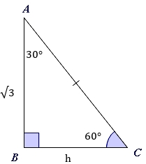
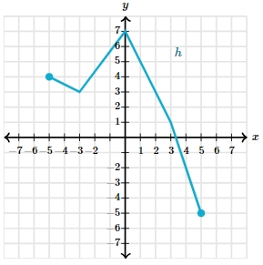

# AVP0384 — Single visual target

MathVerse:369 / MathVerse:558 · different type · Mathematical roles of symbols

## Shared or similar visual information

The letter h

## Evidence locations

- Left image: h below the horizontal base BC
- Right image: h beside the cyan polyline

## Mathematical meanings

Left image: h denotes the unknown length of side BC. Right image: h names the function represented by the indicated curve.

## Same mathematical meanings

no

## Rationales

On the left, attachment to h below the horizontal base BC supports the meaning: h denotes the unknown length of side BC. On the right, the context is h beside the cyan polyline, where h names the function represented by the indicated curve. The same visible notation is assigned to different mathematical objects or quantities in these contexts.

Only the selected target is annotated. AI visual-review draft; not independently double-annotated by humans.
