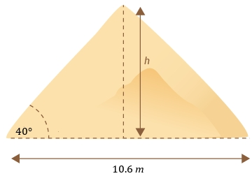
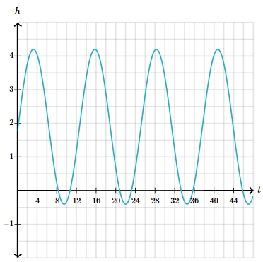

# AVP0385 — Single visual target

MathVerse:367 / MathVerse:549 · different type · Mathematical roles of symbols

## Shared or similar visual information

The letter h

## Evidence locations

- Left image: h beside the vertical dashed height inside the pyramid
- Right image: h above the vertical axis in the wave graph

## Mathematical meanings

Left image: h denotes the unknown vertical height of the pyramid. Right image: h names the quantity encoded by the vertical-axis readings.

## Same mathematical meanings

no

## Rationales

On the left, attachment to h beside the vertical dashed height inside the pyramid supports the meaning: h denotes the unknown vertical height of the pyramid. On the right, the context is h above the vertical axis in the wave graph, where h names the quantity encoded by the vertical-axis readings. The same visible notation is assigned to different mathematical objects or quantities in these contexts.

Only the selected target is annotated. AI visual-review draft; not independently double-annotated by humans.
