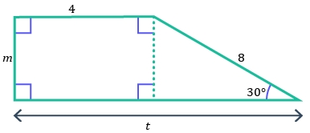

# AVP0386 — Single visual target

MathVerse:379 / MathVerse:546 · different type · Mathematical roles of symbols

## Shared or similar visual information

The letter t

## Evidence locations

- Left image: t below the double-headed dimension along the whole bottom
- Right image: t at the right end of the horizontal axis

## Mathematical meanings

Left image: t denotes the unknown total horizontal length. Right image: t labels the horizontal independent-variable axis.

## Same mathematical meanings

no

## Rationales

On the left, attachment to t below the double-headed dimension along the whole bottom supports the meaning: t denotes the unknown total horizontal length. On the right, the context is t at the right end of the horizontal axis, where t labels the horizontal independent-variable axis. The same visible notation is assigned to different mathematical objects or quantities in these contexts.

Only the selected target is annotated. AI visual-review draft; not independently double-annotated by humans.
