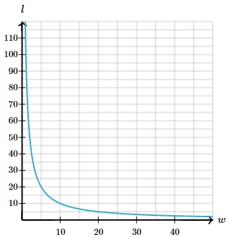

# AVP0387 — Single visual target

MathVerse:359 / MathVerse:550 · different type · Mathematical roles of symbols

## Shared or similar visual information

The letter w

## Evidence locations

- Left image: w beside the upper horizontal distance segment
- Right image: w at the right end of the horizontal axis

## Mathematical meanings

Left image: w denotes the unknown length of the indicated horizontal segment. Right image: w labels the horizontal independent-variable axis.

## Same mathematical meanings

no

## Rationales

On the left, attachment to w beside the upper horizontal distance segment supports the meaning: w denotes the unknown length of the indicated horizontal segment. On the right, the context is w at the right end of the horizontal axis, where w labels the horizontal independent-variable axis. The same visible notation is assigned to different mathematical objects or quantities in these contexts.

Only the selected target is annotated. AI visual-review draft; not independently double-annotated by humans.
