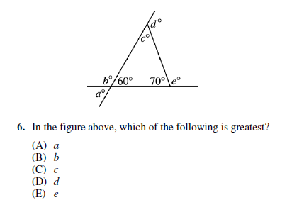
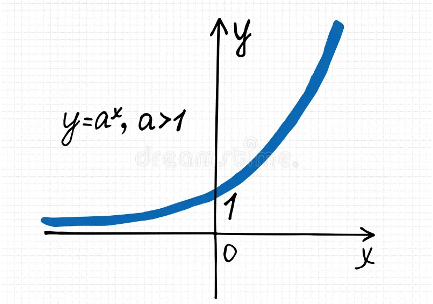

# AVP0389 — Single visual target

MathVista:342 / MathVista:39 · different type · Mathematical roles of symbols

## Shared or similar visual information

The letter a

## Evidence locations

- Left image: a° below the base line at the lower-left crossing
- Right image: a in y = a^x, a > 1 to the left of the curve

## Mathematical meanings

Left image: a denotes the unknown exterior angle measure at the lower-left crossing, in degrees. Right image: a is the fixed base parameter of the exponential function, constrained to exceed 1.

## Same mathematical meanings

no

## Rationales

On the left, attachment to a° below the base line at the lower-left crossing supports the meaning: a denotes the unknown exterior angle measure at the lower-left crossing, in degrees. On the right, the context is a in y = a^x, a > 1 to the left of the curve, where a is the fixed base parameter of the exponential function, constrained to exceed 1. The same visible notation is assigned to different mathematical objects or quantities in these contexts.

Only the selected target is annotated. AI visual-review draft; not independently double-annotated by humans.
