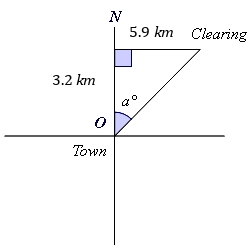
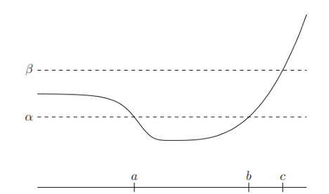

# AVP0390 — Single visual target

MathVerse:343 / MathVista:723 · different type · Mathematical roles of symbols

## Shared or similar visual information

The letter a

## Evidence locations

- Left image: a° beside the angle between north and the slanted route at O
- Right image: a above its tick on the bottom horizontal axis

## Mathematical meanings

Left image: a denotes the unknown direction angle in degrees. Right image: a denotes a selected horizontal input-coordinate value.

## Same mathematical meanings

no

## Rationales

On the left, attachment to a° beside the angle between north and the slanted route at O supports the meaning: a denotes the unknown direction angle in degrees. On the right, the context is a above its tick on the bottom horizontal axis, where a denotes a selected horizontal input-coordinate value. The same visible notation is assigned to different mathematical objects or quantities in these contexts.

Only the selected target is annotated. AI visual-review draft; not independently double-annotated by humans.
