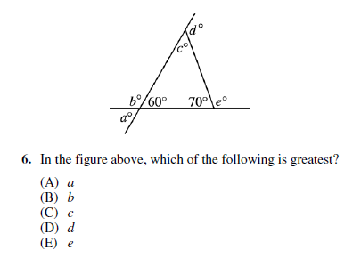
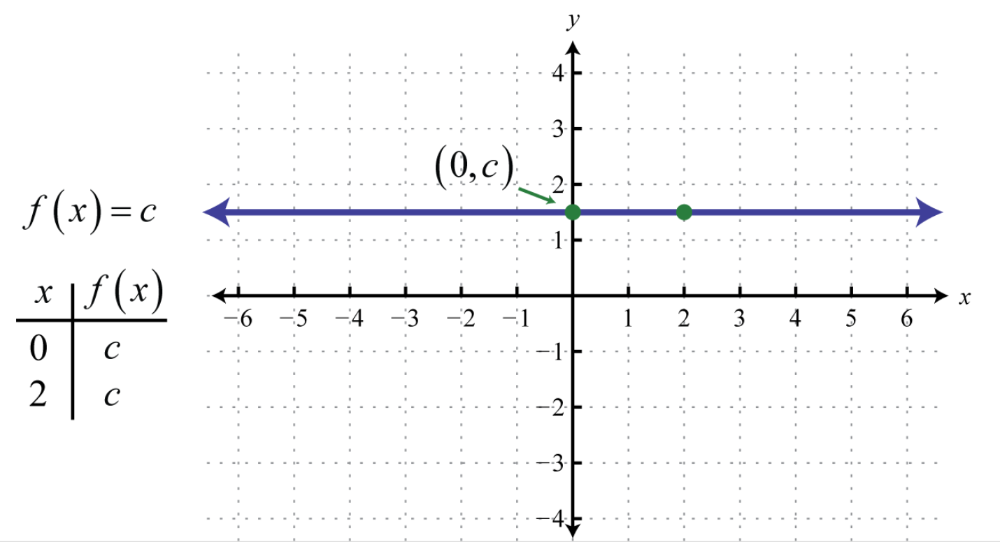

# AVP0391 — Single visual target

MathVista:342 / MathVista:223 · different type · Mathematical roles of symbols

## Shared or similar visual information

The letter c

## Evidence locations

- Left image: c° at the top interior angle
- Right image: c in f(x) = c and at the height of the horizontal graph

## Mathematical meanings

Left image: c denotes the unknown top interior angle measure, in degrees. Right image: c is the constant output value of the horizontal function.

## Same mathematical meanings

no

## Rationales

On the left, attachment to c° at the top interior angle supports the meaning: c denotes the unknown top interior angle measure, in degrees. On the right, the context is c in f(x) = c and at the height of the horizontal graph, where c is the constant output value of the horizontal function. The same visible notation is assigned to different mathematical objects or quantities in these contexts.

Only the selected target is annotated. AI visual-review draft; not independently double-annotated by humans.
