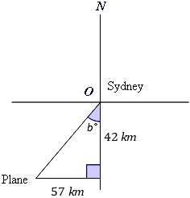
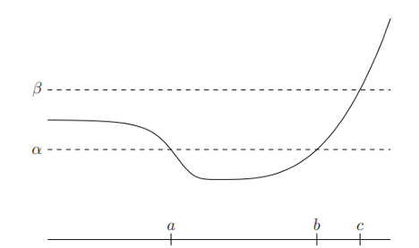

# AVP0392 — Single visual target

MathVerse:344 / MathVista:723 · different type · Mathematical roles of symbols

## Shared or similar visual information

The letter b

## Evidence locations

- Left image: b° beside the angle between the downward vertical and the slanted route
- Right image: b above its tick on the bottom horizontal axis

## Mathematical meanings

Left image: b denotes the unknown direction angle in degrees. Right image: b denotes a selected horizontal input-coordinate value.

## Same mathematical meanings

no

## Rationales

On the left, attachment to b° beside the angle between the downward vertical and the slanted route supports the meaning: b denotes the unknown direction angle in degrees. On the right, the context is b above its tick on the bottom horizontal axis, where b denotes a selected horizontal input-coordinate value. The same visible notation is assigned to different mathematical objects or quantities in these contexts.

Only the selected target is annotated. AI visual-review draft; not independently double-annotated by humans.
