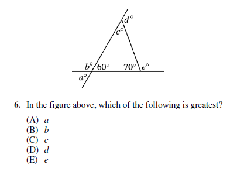
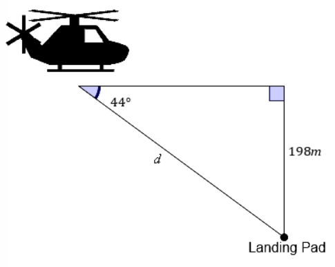

# AVP0393 — Single visual target

MathVista:342 / MathVerse:348 · same type · Mathematical roles of symbols

## Shared or similar visual information

The letter d

## Evidence locations

- Left image: d° at the exterior angle above the top vertex
- Right image: d beside the sloping segment to the landing pad

## Mathematical meanings

Left image: d denotes the unknown exterior angle measure at the top vertex, in degrees. Right image: d denotes the unknown sloping distance to the landing pad.

## Same mathematical meanings

no

## Rationales

On the left, attachment to d° at the exterior angle above the top vertex supports the meaning: d denotes the unknown exterior angle measure at the top vertex, in degrees. On the right, the context is d beside the sloping segment to the landing pad, where d denotes the unknown sloping distance to the landing pad. The same visible notation is assigned to different mathematical objects or quantities in these contexts.

Only the selected target is annotated. AI visual-review draft; not independently double-annotated by humans.
