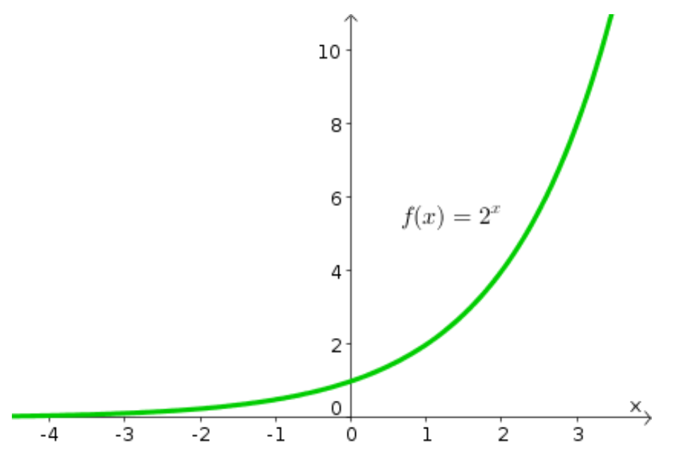
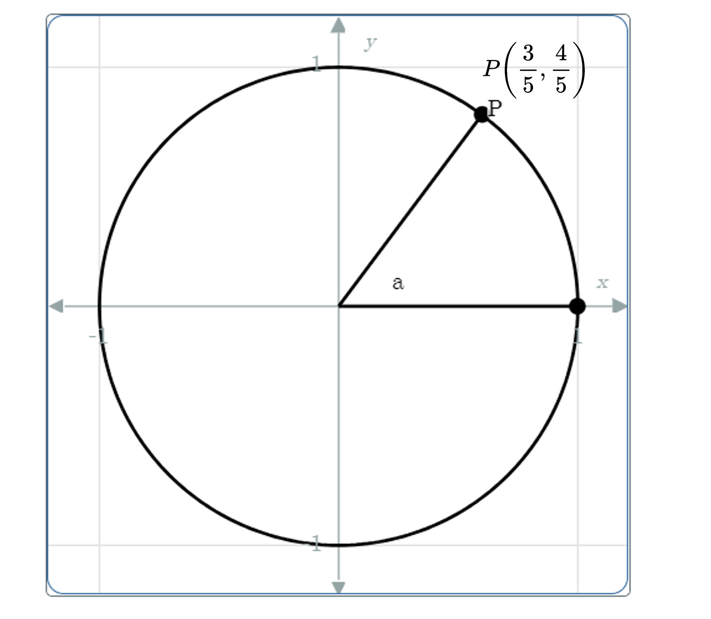

# AVP0394 — Single visual target

MathVista:619 / MathVerse:441 · different type · Mathematical roles of symbols

## Shared or similar visual information

Parentheses in mathematical notation

## Evidence locations

- Left image: (x) in f(x) = 2^x
- Right image: P(3/5, 4/5) beside the point on the circle

## Mathematical meanings

Left image: The parentheses specify the input x of function f; f(x) denotes its output. Right image: The parentheses give the ordered horizontal and vertical coordinates of point P.

## Same mathematical meanings

no

## Rationales

On the left, attachment to (x) in f(x) = 2^x supports the meaning: The parentheses specify the input x of function f; f(x) denotes its output. On the right, the context is P(3/5, 4/5) beside the point on the circle, where The parentheses give the ordered horizontal and vertical coordinates of point P. The same visible notation is assigned to different mathematical objects or quantities in these contexts.

Only the selected target is annotated. AI visual-review draft; not independently double-annotated by humans.
