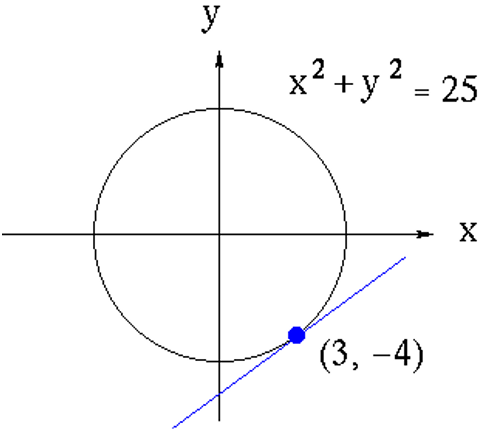

# AVP0395 — Single visual target

MathVista:37 / MathVista:767 · different type · Mathematical roles of symbols

## Shared or similar visual information

Parentheses in mathematical notation

## Evidence locations

- Left image: (x) in g(x) beside the curve
- Right image: (3, −4) beside the marked point on the circle

## Mathematical meanings

Left image: The parentheses specify the input x of function g; g(x) denotes its output. Right image: The parentheses contain the marked point's ordered horizontal and vertical coordinates.

## Same mathematical meanings

no

## Rationales

On the left, attachment to (x) in g(x) beside the curve supports the meaning: The parentheses specify the input x of function g; g(x) denotes its output. On the right, the context is (3, −4) beside the marked point on the circle, where The parentheses contain the marked point's ordered horizontal and vertical coordinates. The same visible notation is assigned to different mathematical objects or quantities in these contexts.

Only the selected target is annotated. AI visual-review draft; not independently double-annotated by humans.
