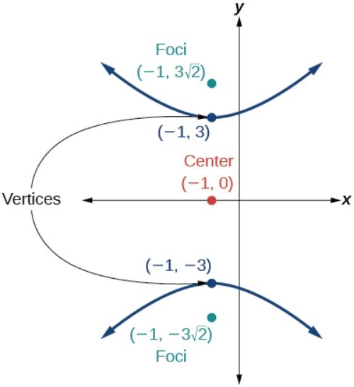

# AVP0396 — Single visual target

MathVista:23 / MathVerse:437 · different type · Mathematical roles of symbols

## Shared or similar visual information

Parentheses in mathematical notation

## Evidence locations

- Left image: (x) in f(x) = |2x − 3| + 1
- Right image: (−1, 3) beside the upper hyperbola vertex

## Mathematical meanings

Left image: The parentheses specify the input x of function f; f(x) denotes its output. Right image: The parentheses give the ordered horizontal and vertical coordinates of the upper vertex.

## Same mathematical meanings

no

## Rationales

On the left, attachment to (x) in f(x) = |2x − 3| + 1 supports the meaning: The parentheses specify the input x of function f; f(x) denotes its output. On the right, the context is (−1, 3) beside the upper hyperbola vertex, where The parentheses give the ordered horizontal and vertical coordinates of the upper vertex. The same visible notation is assigned to different mathematical objects or quantities in these contexts.

Only the selected target is annotated. AI visual-review draft; not independently double-annotated by humans.
