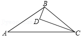
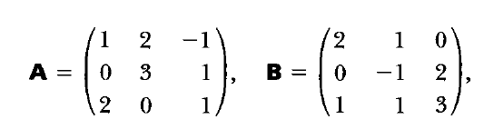

# AVP0397 — Single visual target

MathVista:94 / MathVista:577 · different type · Mathematical roles of symbols

## Shared or similar visual information

The letter A

## Evidence locations

- Left image: A at the lower-left triangle vertex
- Right image: A immediately before the equals sign and its 3-by-3 array

## Mathematical meanings

Left image: A names the indicated geometric point. Right image: A names a 3-by-3 matrix.

## Same mathematical meanings

no

## Rationales

On the left, attachment to A at the lower-left triangle vertex supports the meaning: A names the indicated geometric point. On the right, the context is A immediately before the equals sign and its 3-by-3 array, where A names a 3-by-3 matrix. The same visible notation is assigned to different mathematical objects or quantities in these contexts.

Only the selected target is annotated. AI visual-review draft; not independently double-annotated by humans.
