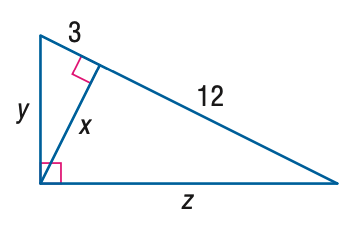

# AVP0399 — Single visual target

MathVista:386 / MathVista:408 · same type · Mathematical roles of symbols

## Shared or similar visual information

The letter y

## Evidence locations

- Left image: y° near the top of the right triangle
- Right image: y beside the left vertical leg

## Mathematical meanings

Left image: y denotes the unknown angle at the top vertex, in degrees. Right image: y denotes the unknown length of the vertical leg.

## Same mathematical meanings

no

## Rationales

On the left, attachment to y° near the top of the right triangle supports the meaning: y denotes the unknown angle at the top vertex, in degrees. On the right, the context is y beside the left vertical leg, where y denotes the unknown length of the vertical leg. The same visible notation is assigned to different mathematical objects or quantities in these contexts.

Only the selected target is annotated. AI visual-review draft; not independently double-annotated by humans.
