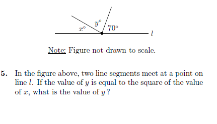
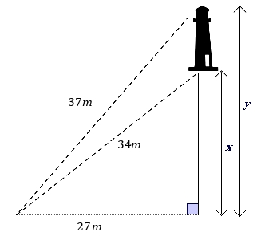

# AVP0400 — Single visual target

MathVista:304 / MathVerse:366 · same type · Mathematical roles of symbols

## Shared or similar visual information

The letter y

## Evidence locations

- Left image: y° between the two upward rays
- Right image: y beside the longer vertical dimension at the right of the lighthouse

## Mathematical meanings

Left image: y denotes the unknown angle measure between the upward rays, in degrees. Right image: y denotes the unknown overall height shown by the longer dimension.

## Same mathematical meanings

no

## Rationales

On the left, attachment to y° between the two upward rays supports the meaning: y denotes the unknown angle measure between the upward rays, in degrees. On the right, the context is y beside the longer vertical dimension at the right of the lighthouse, where y denotes the unknown overall height shown by the longer dimension. The same visible notation is assigned to different mathematical objects or quantities in these contexts.

Only the selected target is annotated. AI visual-review draft; not independently double-annotated by humans.
