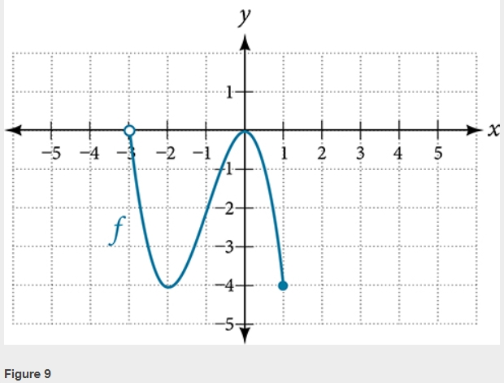

# AVP0401 — Single visual target

MathVista:34 / MathVerse:481 · same type · Mathematical roles of graphical elements

## Shared or similar visual information

A hollow circular marker on a plotted graph

## Evidence locations

- Left image: The hollow circle at the left end of the red horizontal step at height 5.
- Right image: The hollow circle at the left end of the blue curve near x=-3.

## Mathematical meanings

Left image: An excluded endpoint of that step of the function graph. Right image: An excluded point at the left boundary of the displayed graph.

## Same mathematical meanings

yes

## Rationales

In both images the hollow circle removes its particular endpoint from the drawn branch; endpoint coordinates and curve shapes are irrelevant to this exclusion convention.

Only the selected target is annotated. AI visual-review draft; not independently double-annotated by humans.
