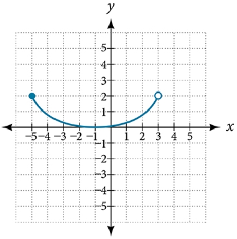

# AVP0402 — Single visual target

MathVista:37 / MathVerse:484 · same type · Mathematical roles of graphical elements

## Shared or similar visual information

A hollow circular marker on a plotted graph

## Evidence locations

- Left image: The hollow circle on the blue curve directly below the separate filled blue point.
- Right image: The hollow circle at the right endpoint of the U-shaped blue curve.

## Mathematical meanings

Left image: A hole: this marked position on the curve is excluded; the separate filled point supplies the function value at the same horizontal coordinate. Right image: An excluded endpoint of the displayed function graph.

## Same mathematical meanings

yes

## Rationales

The first is an interior hole and the second an endpoint, but both hollow circles specifically exclude the marked position. No claim is made about excluding the entire corresponding y-value from the range.

Only the selected target is annotated. AI visual-review draft; not independently double-annotated by humans.
