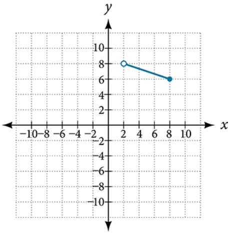

# AVP0403 — Single visual target

MathVista:156 / MathVerse:482 · same type · Mathematical roles of graphical elements

## Shared or similar visual information

A hollow circular marker on a plotted graph

## Evidence locations

- Left image: The hollow circle at the upper end of the sloping straight branch, at x=1.
- Right image: The hollow circle at the upper-left endpoint of the descending blue segment.

## Mathematical meanings

Left image: The straight branch excludes that endpoint, consistent with the printed restriction x<1. Right image: An excluded endpoint of the displayed function segment.

## Same mathematical meanings

yes

## Rationales

The printed x<1 restriction supports endpoint exclusion on the left, and the hollow segment endpoint encodes exclusion on the right. Both use the same open-point convention.

Only the selected target is annotated. AI visual-review draft; not independently double-annotated by humans.
