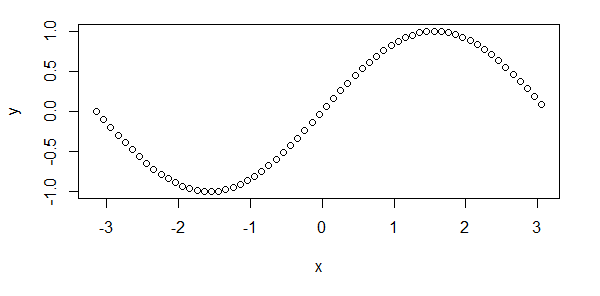

# AVP0404 — Single visual target

MathVista:34 / MathVista:118 · same type · Mathematical roles of graphical elements

## Shared or similar visual information

Small hollow circular plotting symbols

## Evidence locations

- Left image: The hollow circle at the left end of the red horizontal step at height 5.
- Right image: One of the hollow circles near the crest of the plotted sequence of circles.

## Mathematical meanings

Left image: An excluded endpoint of that step of the function graph. Right image: A plotted sample location on the displayed mathematical relation; the hollow glyph is used throughout the sequence and does not mean that the position is excluded.

## Same mathematical meanings

no

## Rationales

Only the first symbol is an open step endpoint. The second image uses hollow circles at every sampled position, including interior ones, so interpreting them all as excluded function values would misread the plot.

Only the selected target is annotated. AI visual-review draft; not independently double-annotated by humans.
